<div align="center">

# Etkileşimli Ders Deneyimi Panosu

**Haftalık ders içeriklerini, öğrenme hedeflerini ve görevleri tek ekrandan takip eden, ilerlemeyi görünür kılan etkileşimli web uygulaması.**

[](https://react.dev)
[](https://vitejs.dev)
[](https://developer.mozilla.org/docs/Web/JavaScript)
[](https://developer.mozilla.org/docs/Web/CSS)
[](#yol-haritası)
[](#lisans)

Yazılım Geliştirme dersi · Proje 1 · **Grup 2**

[Canlı Demo](#demo) · [Kurulum](#kurulum) · [Tasarım](#tasarım) · [Mimari](#mimari) · [Ekip](#ekip-ve-roller)

</div>

---

## İçindekiler

- [Proje hakkında](#proje-hakkında)
- [Demo](#demo)
- [Özellikler](#özellikler)
- [Tasarım](#tasarım)
- [Ekran görüntüleri](#ekran-görüntüleri)
- [Teknoloji yığını](#teknoloji-yığını)
- [Mimari](#mimari)
- [Akış diyagramları](#akış-diyagramları)
- [Veri modeli](#veri-modeli)
- [Kurulum](#kurulum)
- [Kullanım](#kullanım)
- [Gereksinim izlenebilirlik matrisi](#gereksinim-izlenebilirlik-matrisi)
- [Test senaryoları](#test-senaryoları)
- [Erişilebilirlik ve responsive tasarım](#erişilebilirlik-ve-responsive-tasarım)
- [Ekip ve roller](#ekip-ve-roller)
- [Çalışma akışı](#çalışma-akışı)
- [Yol haritası](#yol-haritası)
- [Bilinen eksikler](#bilinen-eksikler)
- [Teslim paketi](#teslim-paketi)
- [Katkı rehberi](#katkı-rehberi)
- [Lisans](#lisans)

---

## Proje hakkında

### Problem

Bir dönem boyunca ders içerikleri, öğrenme hedefleri ve haftalık görevler genellikle birbirinden kopuk kaynaklara dağılır: sunumlar bir yerde, görev listesi başka yerde, öğrencinin kendi ilerlemesi ise hiçbir yerde tutulmaz. Sonuç olarak öğrenci iki soruya hızlı cevap veremez:

> *"Bu hafta tam olarak neyi öğrenmem gerekiyor?"*
> *"Dönemin neresindeyim, neyi tamamladım?"*

### Çözüm

**Etkileşimli Ders Deneyimi Panosu**, ders akışını haftalık kartlar hâlinde yapılandırır; her haftanın öğrenme hedeflerini ve görevlerini aynı bağlamda sunar. Öğrenci görevleri tamamlandı olarak işaretledikçe ilerleme göstergesi anlık güncellenir ve bu durum tarayıcıda kalıcı olarak saklanır. Filtreleme ve arama, uzun dönem planı içinde aranan içeriğe saniyeler içinde ulaşmayı sağlar.

Uygulama bilinçli olarak **bir "yapılacaklar listesi" değildir**: görevler her zaman ait oldukları haftanın ve öğrenme hedefinin bağlamında gösterilir, böylece ilerleme bir sayı değil bir öğrenme hikâyesi hâline gelir.

### Hedef kullanıcılar

| Kullanıcı | Rolü | Temel beklentisi |
|---|---|---|
| **Öğrenci** | Birincil kullanıcı | Haftalık içeriklere erişmek, görevlerini işaretlemek, ilerlemesini görmek, içerikte arama/filtreleme yapmak, panoyu telefonundan da kullanmak |
| **Ders sorumlusu** | Paydaş | Ders akışının öğrenciler tarafından anlaşılır biçimde takip edilebilmesi; başlıklar, hedefler ve görevler arasındaki ilişkinin net olması |

### Teknik kapsam ve sınırlar

Projenin odağı **istemci tarafı web geliştirme, kullanılabilirlik ve etkileşim tasarımıdır.** Bu kapsam gereği:

- ✅ Uygulama tamamen tarayıcıda çalışır, sunucu gerektirmez.
- ✅ Ders içerikleri statik bir JSON dosyasından okunur.
- ✅ Kullanıcıya ait durumlar (görev işaretlemeleri, tema tercihi) `localStorage` içinde saklanır.
- ❌ Veri tabanı, backend servisi veya kullanıcı hesabı **kapsam dışıdır**.

---

## Demo

> **Durum:** Yayına alınacak · bkz. [Yol haritası](#yol-haritası)

| | |
|---|---|
| **Canlı uygulama** | `https://senacakmak6161.github.io/yazilim-gelistirme-proje1/` <!-- TODO: yayına alınınca doğrula --> |
| **Kaynak kod** | [github.com/senacakmak6161/yazilim-gelistirme-proje1](https://github.com/senacakmak6161/yazilim-gelistirme-proje1) |
| **Yerelde çalıştırma** | [Kurulum](#kurulum) bölümü · ~2 dakika |

### Demo senaryoları

Canlı sunumda uçtan uca gösterilecek akışlar:

1. **Haftalık akışı inceleme** — Uygulama açılır, haftalık kartlar listelenir, bir hafta seçilir, o haftanın öğrenme hedefleri ve görevleri görüntülenir.
2. **Görev ilerlemesi** — Bir görev tamamlandı olarak işaretlenir, ilerleme göstergesi anında güncellenir, sayfa yenilendiğinde durum korunur.
3. **Filtreleme ve arama** — "Devam edenler" filtresi uygulanır, ardından anahtar kelimeyle arama yapılır; iki kısıt birlikte çalışır.
4. **Kenar durumu** — Eşleşen görev bulunmayan bir arama yapılır; kullanıcıya anlaşılır bir boş durum mesajı gösterilir.
5. **Kişiselleştirme ve mobil** — Tema değiştirilir, tercih kalıcı olur; dar ekran görünümünde temel işlevlerin çalıştığı gösterilir.

---

## Özellikler

### Temel işlevler

| | Özellik | Açıklama |
|---|---|---|
| 📅 | **Haftalık ders kartları** | Her hafta için hafta numarası, başlık ve açıklama içeren kartlar; seçilen hafta genişletilerek detaya inilir. |
| 🎯 | **Öğrenme hedefleri** | Her haftanın kazanımları, ait olduğu haftayla doğru eşleşmiş biçimde okunabilir şekilde sunulur. |
| ✅ | **Görev takibi** | Mini görevler ve etkinlikler listelenir; tamamlanma durumu tek tıkla değiştirilir, tamamlananlar görsel olarak ayırt edilir, işaret geri alınabilir. |
| 🔍 | **Arama** | Görev başlıkları ve açıklamaları içinde anahtar kelime araması; sonuçlar yazdıkça anlık güncellenir. |
| 🎚️ | **Filtreleme** | Görevler tamamlanma durumuna (*tümü / devam eden / tamamlanan*) **ve** haftaya göre filtrelenir; iki filtre birlikte uygulanabilir. |
| 📊 | **İlerleme göstergesi** | Tamamlanan / toplam görev sayısı ve yüzde oranı; sayısal değer ile görsel ilerleme çubuğu her zaman birbiriyle tutarlıdır. |
| 🌓 | **Karanlık / aydınlık tema** | CSS değişkenleri üzerinden anlık tema geçişi; tercih kalıcı olarak saklanır. |
| 📱 | **Responsive tasarım** | Telefon, tablet ve masaüstünde kullanılabilir; mobilde yatay kaydırma gerekmez. |
| 💾 | **Veri kalıcılığı** | Görev durumları ve tema tercihi `localStorage` üzerinden saklanır, sayfa yenilendiğinde geri yüklenir. |
| ♿ | **Erişilebilirlik** | Anlamlı etiketler, yeterli renk kontrastı, klavyeyle kullanılabilir kontroller. |

### Kullanıcı deneyimi detayları

Temel gereksinimlerin ötesinde, kullanılabilirliği doğrudan etkileyen davranışlar:

- **Boş durum mesajları** — Filtre veya arama sonucunda eşleşen görev kalmadığında, içerik bulunmayan bir hafta açıldığında kullanıcıya ne olduğunu açıklayan bir mesaj gösterilir; boş ekran bırakılmaz.
- **Bağımsız durum güncellemeleri** — Bir görevin durumu değiştirilirken diğer görevlerin durumu etkilenmez.
- **Filtre saflığı** — Filtreleme ve arama yalnızca görünürlüğü etkiler; görevlerin gerçek tamamlanma durumlarını **değiştirmez**.
- **Sıfıra bölme koruması** — Toplam görev sayısı sıfır olduğunda ilerleme hesabı hata üretmez.
- **Tema izolasyonu** — Tema değişimi görev durumlarını etkilemez.

> Bu davranışların her biri, [kabul kriterleri](#gereksinim-izlenebilirlik-matrisi) belgesinde tanımlanmış ve [test senaryolarıyla](#test-senaryoları) doğrulanmıştır.

---

## Tasarım

Arayüz, geliştirmeye başlamadan önce tasarlandı. Tam tasarım belgesi — renk sistemi, tipografi,
hareket kuralları ve bileşen eşlemesiyle birlikte — şurada:
**[`docs/tasarim/Tasarim-ve-Arayuz-Taslagi.pdf`](docs/tasarim/Tasarim-ve-Arayuz-Taslagi.pdf)**

Geliştirmeye başlarken tasarım sisteminin nasıl uygulanacağı:
[`docs/tasarim/iskelet-kurulum-rehberi.md`](docs/tasarim/iskelet-kurulum-rehberi.md)

### Konsept: Ders Patikası

Ders dönemi bir **patika**, her hafta bu patikada bir **durak**. Tamamlanan haftalar arkada kalan
yol olarak dolu çizilir, bulunulan hafta işaretlenir, gelecek haftalar kesikli çizgiyle beklemede
durur. İlerleme bir yüzde değil, **kat edilen mesafedir**.

Bu tercih keyfî değil: teknik doküman uygulamanın *"klasik to-do list görünümüne
indirgenmemesini"* ve öğrenme ilerlemesinin *"görsel olarak anlamlı biçimde sunulmasını"* istiyor.

### Wireframe — ne nerede, neden

<div align="center">

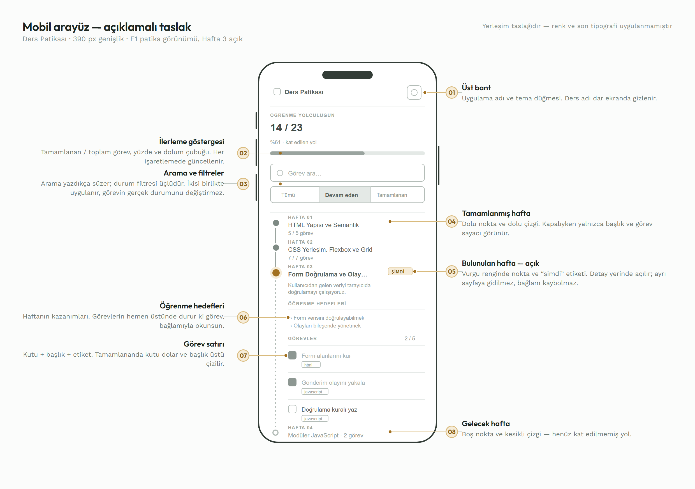

_Mobil · 390 px — sekiz numaralı açıklama her bölgenin ne olduğunu ve neden orada durduğunu anlatır_

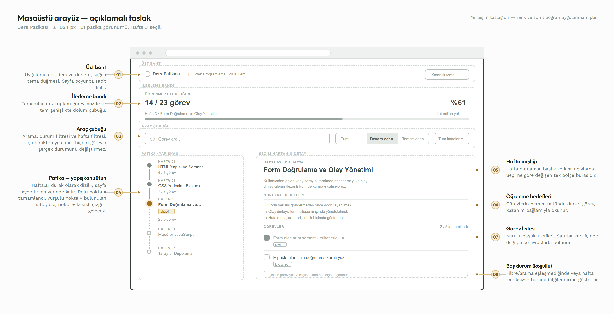

_Masaüstü · ≥ 1024 px — asimetrik iki sütun: solda yapışkan patika, sağda seçili haftanın detayı_

</div>

### Ekran akışı

<div align="center">

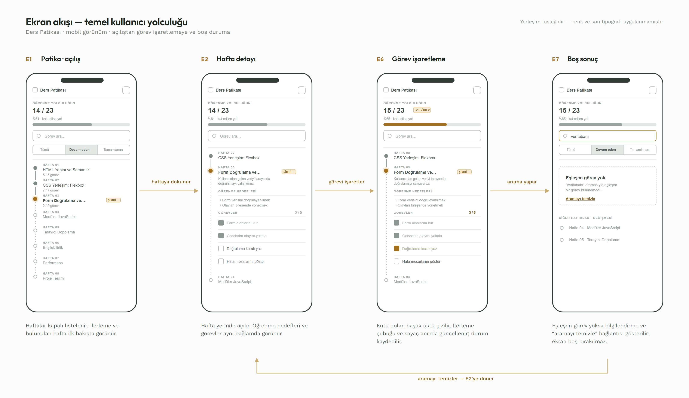

_Açılıştan görev işaretlemeye ve boş duruma kadar temel kullanıcı yolculuğu_

</div>

Uygulama **tek sayfadır**; ayrı adresler yerine görünüm durumları vardır. Akışta görünmeyen yan
durumlar:

<div align="center">

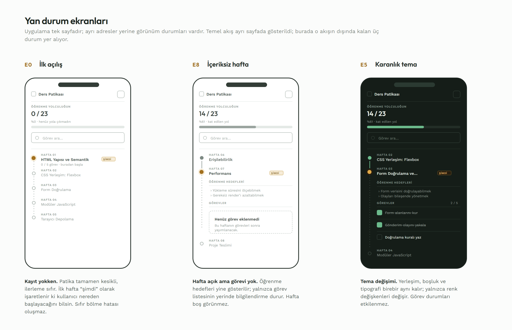

_İlk açılış (kayıt yokken), içeriksiz hafta ve karanlık tema_

</div>

### Tasarım uygulanmış hâli

<div align="center">

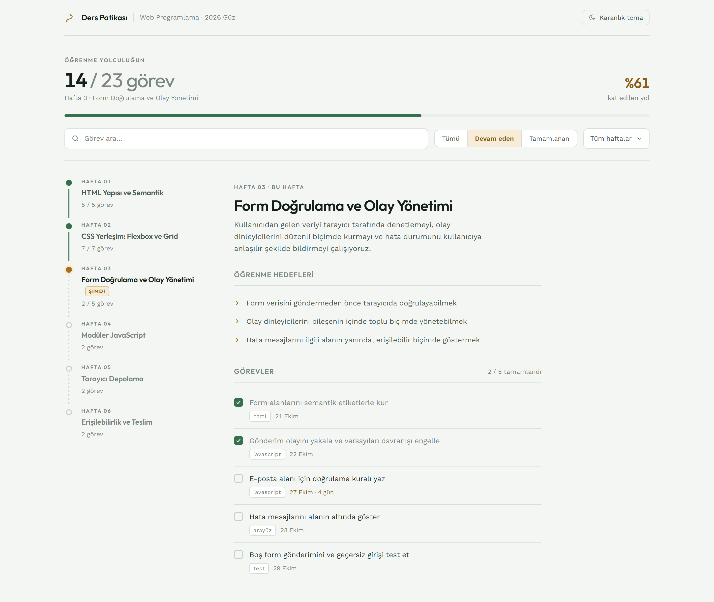

_Masaüstü · aydınlık tema_

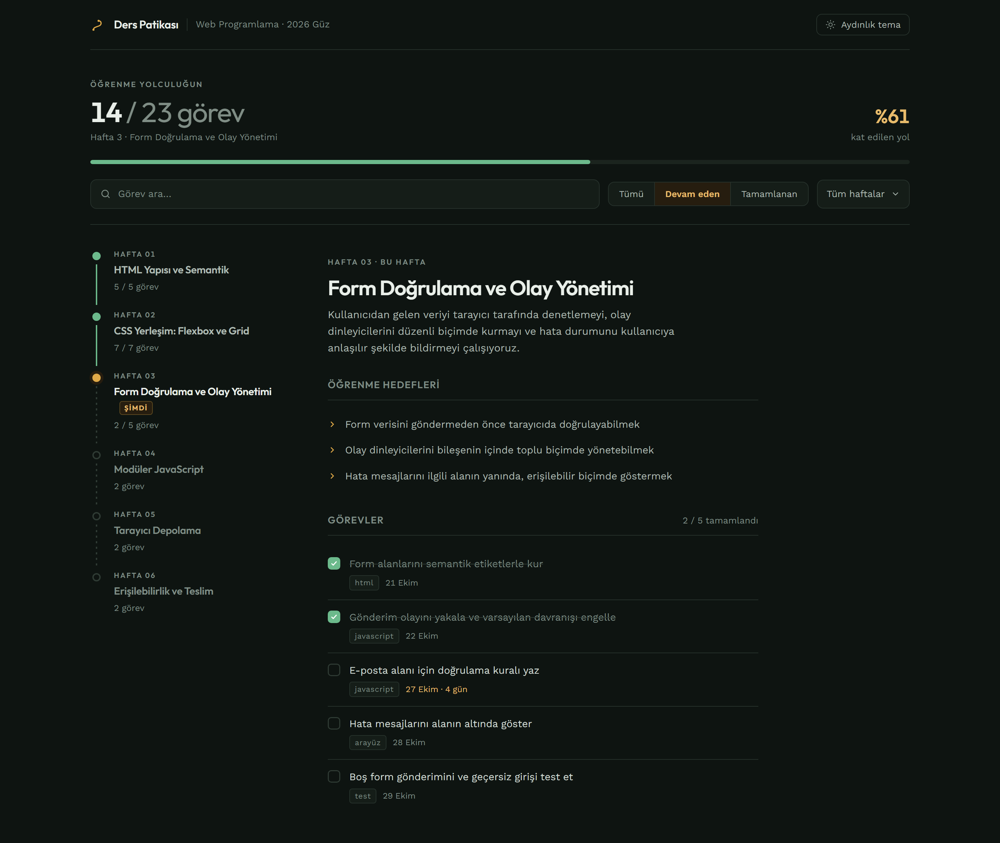

_Masaüstü · karanlık tema — aynı yerleşim, yalnızca renk değişkenleri değişir_

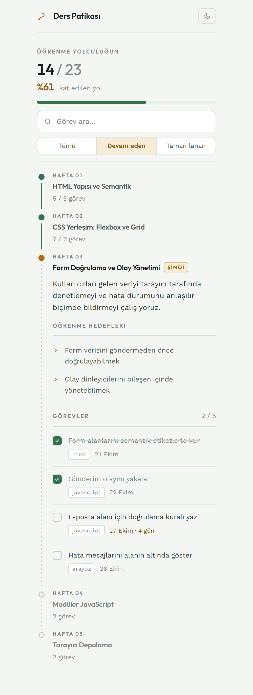

_Mobil · 390 px_

</div>

> **Not:** Yukarıdakiler tasarım taslaklarıdır, çalışan uygulamanın ekran görüntüsü değildir.
> Gerçek ekran görüntüleri aşağıdaki bölüme, uygulama çalışır hâle geldiğinde eklenecektir.

---

## Ekran görüntüleri

<!-- TODO: Uygulama çalışır hâle geldiğinde görseller docs/screenshots/ altına eklenip buraya bağlanacak -->

Çalışan uygulamanın ekran görüntüleri geliştirme tamamlandığında bu bölüme eklenecektir.

| Görünüm | Durum |
|---|---|
| Masaüstü — aydınlık tema | _bekliyor_ |
| Masaüstü — karanlık tema | _bekliyor_ |
| Mobil görünüm | _bekliyor_ |
| Boş durum ekranı | _bekliyor_ |

---

## Teknoloji yığını

Ders kapsamında teknoloji seçimi serbesttir. Aşağıdaki tercihler, projenin **istemci tarafı odağı** ve **dört kişilik ekibin paralel çalışma ihtiyacı** göz önünde bulundurularak yapılmıştır.

| Katman | Teknoloji | Seçim gerekçesi |
|---|---|---|
| **Arayüz** | React 18 | Arayüzün yeniden kullanılabilir bileşenlere ayrılmasını sağlar. Görev durumu, filtre ve arama gibi sürekli değişen veriler bileşen state'i üzerinden yönetildiği için arayüzün veriyle tutarlı kalması garanti altına alınır. Ekip üyelerinin ayrı bileşenler üzerinde eşzamanlı çalışmasına imkân verir. |
| **Derleme ortamı** | Vite 5 | Hızlı geliştirme sunucusu ve sade yapılandırma sunar. Üretim derlemesi tamamen statik dosyalar ürettiği için uygulama sunucu gerektirmeden yayınlanabilir. |
| **Stil** | Saf CSS + CSS Custom Properties | Tema geçişi, renklerin CSS değişkenleri üzerinden tanımlanmasıyla tek bir sınıf değişimiyle çözülür. Hazır bir UI kütüphanesi yerine kendi tasarım kararlarımızı uygulamayı tercih ettik; böylece her stil kararını gerekçelendirebiliyoruz. |
| **Tipografi** | Outfit (başlık) + Work Sans (gövde), `@fontsource` ile | Geometrik ve karakterli bir başlık yazı tipi ile yüksek okunabilirlikli bir gövde yazı tipi eşleştirildi. Paket olarak kurulduğu için demo ortamında internet bağlantısı gerektirmez. |
| **Düzen** | CSS Flexbox & Grid + Media Query | Harici bir grid sistemine ihtiyaç duymadan üç kırılım noktasında responsive yerleşim sağlanır. |
| **Veri** | Statik JSON + `localStorage` | Projede veri tabanı zorunlu değildir. Ders içerikleri sürüm kontrolünde tutulan bir JSON dosyasından okunur; kullanıcıya özel durumlar tarayıcıda saklanır. |
| **Sürüm kontrolü** | Git & GitHub | Kaynak kod yönetimi, issue takibi ve bireysel katkıların kayıt altına alınması. |
| **Yayın** | GitHub Pages | Statik çıktı için ek altyapı gerektirmeyen, ücretsiz ve repoyla bütünleşik yayın ortamı. |

**Harici UI kütüphanesi kullanılmamıştır.** Tüm arayüz bileşenleri ve stil kararları ekip tarafından oluşturulmuştur.

---

## Mimari

### Tasarım ilkeleri

> Arayüz tasarımının gerekçeleri, renk sistemi ve bileşen eşlemesi için bkz.
> [Tasarım](#tasarım) bölümü ve [tasarım belgesi](docs/tasarim/Tasarim-ve-Arayuz-Taslagi.pdf).

1. **Tek doğruluk kaynağı** — Görev durumları yalnızca `App` bileşeninde tutulur. Alt bileşenler kendi kopyalarını saklamaz; güncellemeleri geri çağırma (callback) fonksiyonlarıyla yukarı iletir. Bu sayede görev listesi ile ilerleme göstergesinin tutarsızlaşması yapısal olarak engellenir.
2. **Türetilmiş veri hesaplanır, saklanmaz** — Filtrelenmiş görev listesi ve ilerleme yüzdesi ayrı bir state'te tutulmaz; her render'da mevcut veriden türetilir. Böylece senkronizasyon hatası oluşmaz.
3. **Yan etkiler hook'lara izole edilir** — `localStorage` erişimi tek bir özel hook içinde toplanır; bileşenler depolama detayını bilmez.
4. **Sunum ve mantık ayrımı** — Bileşenler mümkün olduğunca gösterim odaklıdır; filtreleme, arama ve hesaplama mantığı saf yardımcı fonksiyonlarda tutulur ve bağımsız olarak test edilebilir.

### Bileşen hiyerarşisi

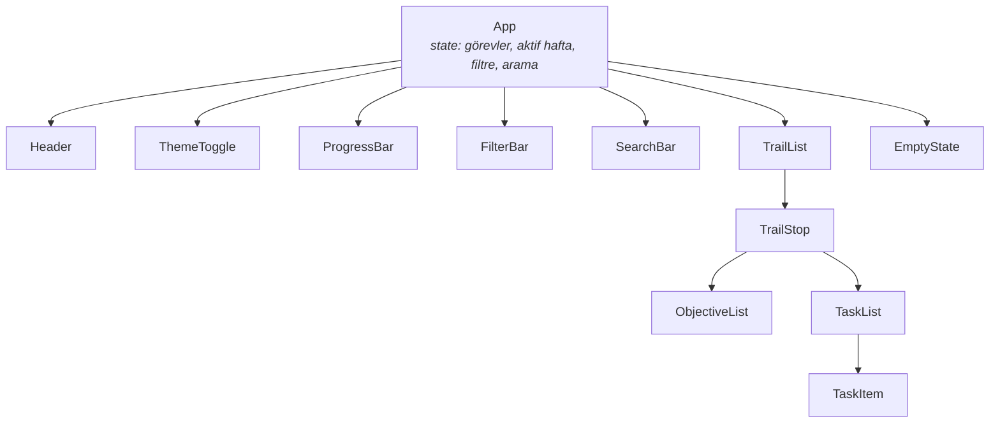

### Veri akışı

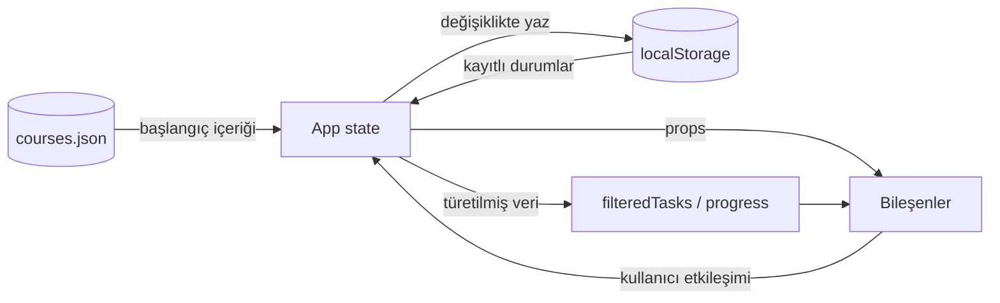

### Dizin yapısı

```
yazilim-gelistirme-proje1/
├── src/
│   ├── components/              # React bileşenleri
│   │   ├── Header.jsx
│   │   ├── ThemeToggle.jsx
│   │   ├── ProgressBar.jsx
│   │   ├── FilterBar.jsx
│   │   ├── SearchBar.jsx
│   │   ├── TrailList.jsx
│   │   ├── TrailStop.jsx
│   │   ├── ObjectiveList.jsx
│   │   ├── TaskList.jsx
│   │   ├── TaskItem.jsx
│   │   └── EmptyState.jsx
│   ├── hooks/
│   │   ├── useLocalStorage.js   # Kalıcı durum yönetimi
│   │   └── useTheme.js          # Tema tercihi
│   ├── utils/
│   │   ├── filterTasks.js       # Filtre + arama mantığı
│   │   └── calculateProgress.js # İlerleme hesabı
│   ├── data/
│   │   └── courses.json         # Haftalık ders içerikleri
│   ├── styles/
│   │   ├── variables.css        # Tema değişkenleri (aydınlık/karanlık)
│   │   ├── global.css
│   │   └── responsive.css       # Kırılım noktaları
│   ├── App.jsx
│   └── main.jsx
├── docs/
│   ├── tasarim/                 # Tasarım belgesi, wireframe ve mockup görselleri
│   │   ├── Tasarim-ve-Arayuz-Taslagi.pdf
│   │   ├── img/                 # PNG çıktılar
│   │   └── mockup/              # Görsellerin kaynak HTML/CSS dosyaları
│   ├── proje-raporu.pdf
│   └── kullanici-dokumani.pdf
├── presentation/                # Sunum dosyası
├── index.html
├── vite.config.js
└── package.json
```

---

## Akış diyagramları

### Kullanıcı akışı

Uygulamanın açılışından itibaren kullanıcının izleyebileceği tüm yollar. Her ana işlev,
kullanıcıyı merkezî seçim noktasına geri döndürür; böylece işlevler birbirini kesmeden
ardışık olarak kullanılabilir.

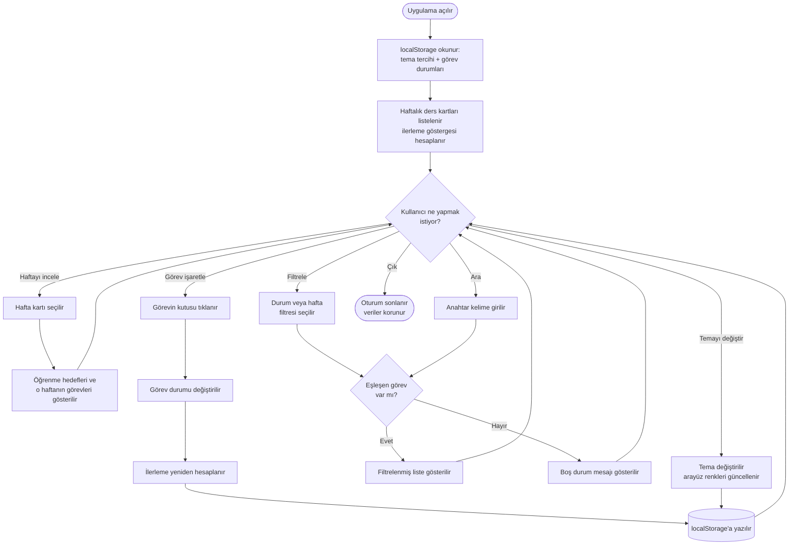

### Görev durumu akışı

Bir görevin yaşam döngüsü. Durum değişikliği her zaman iki yan etki üretir: ilerleme
göstergesinin güncellenmesi ve durumun kalıcı olarak saklanması.

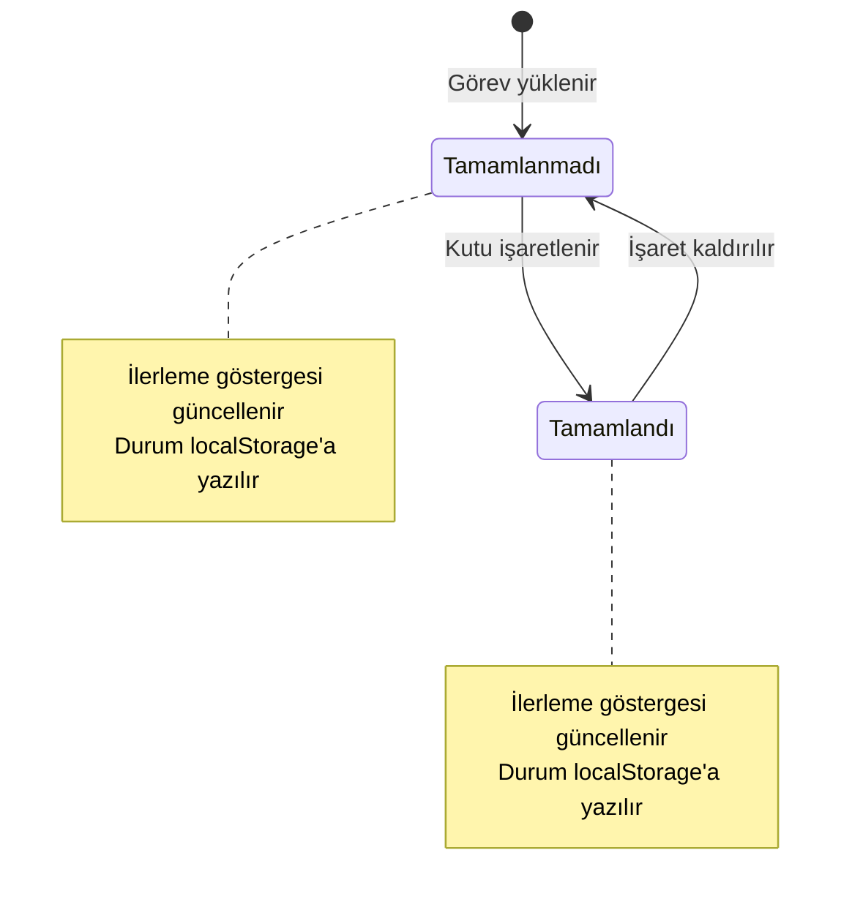

### Veri kalıcılığı akışı

Sayfa yenilendiğinde kullanıcı durumunun nasıl geri yüklendiği. Bozuk veya eksik kayıt
durumunda uygulama çökmez, varsayılan değerlere döner.

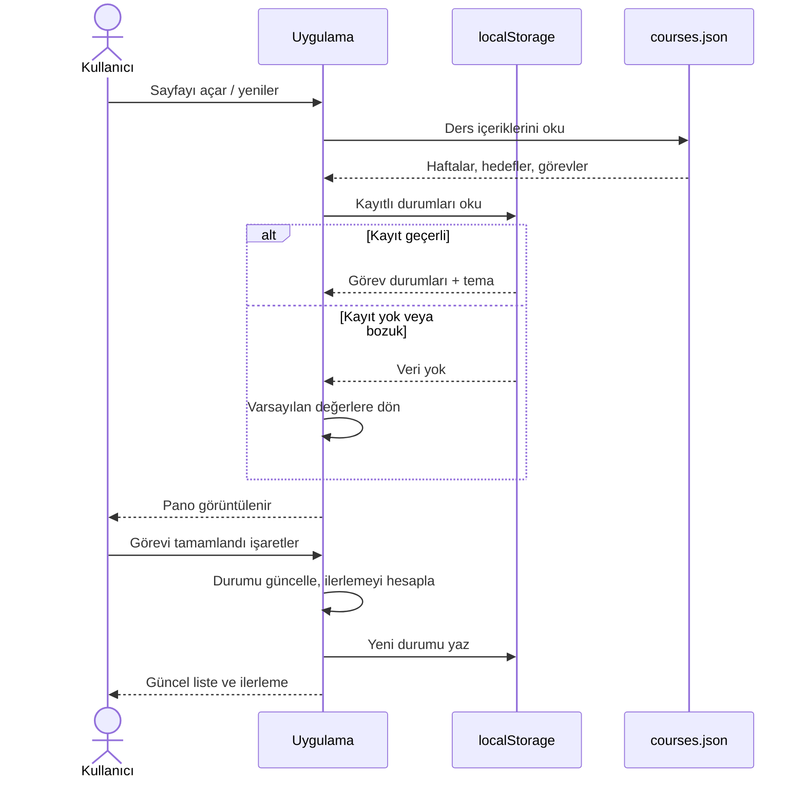

---

## Veri modeli

Uygulama iki veri kaynağı kullanır: **sürüm kontrolündeki statik içerik** ve **tarayıcıdaki kullanıcı durumu.**

### Ders içeriği — `src/data/courses.json`

```json
{
  "course": {
    "title": "Yazılım Geliştirme",
    "term": "2026 Güz"
  },
  "weeks": [
    {
      "id": 1,
      "weekNumber": 1,
      "title": "İhtiyaç Analizi ve Planlama",
      "description": "Kullanıcı ihtiyaçlarının belirlenmesi, kullanıcı hikâyeleri ve kabul kriterleri.",
      "objectives": [
        "Hedef kullanıcıları ve beklentilerini tanımlayabilmek",
        "Kullanıcı hikâyesi yazabilmek",
        "Test edilebilir kabul kriteri oluşturabilmek"
      ],
      "tasks": [
        {
          "id": "w1-t1",
          "title": "Kullanıcı hikâyelerini çıkar",
          "description": "Belirlenen ihtiyaçları US formatında yaz.",
          "dueDate": "2026-10-28",
          "tags": ["analiz"]
        }
      ]
    }
  ]
}
```

| Varlık | Alan | Tip | Açıklama |
|---|---|---|---|
| **Week** | `id` | number | Benzersiz hafta kimliği |
| | `weekNumber` | number | Görüntülenen hafta numarası |
| | `title` | string | Hafta başlığı |
| | `description` | string | Kısa açıklama |
| | `objectives` | string[] | Öğrenme hedefleri |
| | `tasks` | Task[] | O haftaya ait görevler |
| **Task** | `id` | string | Benzersiz görev kimliği (`w{hafta}-t{sıra}`) |
| | `title` | string | Görev başlığı |
| | `description` | string | Açıklama |
| | `dueDate` | string \| null | ISO tarih, isteğe bağlı |
| | `tags` | string[] | Etiketler |

> **Not:** Görevin tamamlanma durumu bilinçli olarak bu dosyada tutulmaz. İçerik herkes için ortaktır; tamamlanma durumu kullanıcıya özeldir ve aşağıdaki katmanda saklanır.

### Kullanıcı durumu — `localStorage`

| Anahtar | Tip | Örnek | Açıklama |
|---|---|---|---|
| `ddp.taskStatus` | `Record<string, boolean>` | `{ "w1-t1": true, "w2-t3": false }` | Görev kimliği → tamamlanma durumu |
| `ddp.theme` | `"light" \| "dark"` | `"dark"` | Seçilen tema |
| `ddp.filters` | `object` | `{ "status": "active", "week": "all" }` | Son kullanılan filtre tercihi |

**Dayanıklılık kuralı:** `localStorage` okunurken içerik bozuk veya beklenen biçimde değilse uygulama çökmez; varsayılan değerlere dönülür. `courses.json` içinde artık bulunmayan bir göreve ait kayıt sessizce yok sayılır.

### İlerleme hesabı

```
ilerleme (%) = (tamamlanan görev sayısı / toplam görev sayısı) × 100
```

Toplam görev sayısı `0` olduğunda hesaplama yapılmaz, ilerleme `%0` olarak gösterilir.
*Örnek:* 10 görevden 6'sı tamamlandığında ilerleme `(6 / 10) × 100 = %60`.

---

## Kurulum

### Ön koşullar

| Gereksinim | Sürüm | Kontrol |
|---|---|---|
| [Node.js](https://nodejs.org/) | **18 veya üzeri** (LTS önerilir) | `node -v` |
| npm | 9 veya üzeri (Node ile gelir) | `npm -v` |
| [Git](https://git-scm.com/) | Herhangi bir güncel sürüm | `git --version` |

### Adımlar

```bash
# 1. Depoyu klonlayın
git clone https://github.com/senacakmak6161/yazilim-gelistirme-proje1.git

# 2. Proje dizinine girin
cd yazilim-gelistirme-proje1

# 3. Bağımlılıkları yükleyin
npm install

# 4. Geliştirme sunucusunu başlatın
npm run dev
```

Terminalde görünen adresi (varsayılan: **http://localhost:5173**) tarayıcıda açın. Uygulama ilk açılışta örnek ders verisiyle gelir; ek bir yapılandırma veya ortam değişkeni gerekmez.

### Komutlar

| Komut | Açıklama |
|---|---|
| `npm run dev` | Geliştirme sunucusunu başlatır (hot reload). |
| `npm run build` | Üretim derlemesini `dist/` klasörüne üretir. |
| `npm run preview` | Üretim derlemesini yerelde önizler. |

### Sorun giderme

<details>
<summary><b>npm install hata veriyor</b></summary>

Node sürümünüzü kontrol edin (`node -v`); 18'in altındaysa güncelleyin. Sorun sürerse `node_modules` klasörünü ve `package-lock.json` dosyasını silip `npm install` komutunu tekrar çalıştırın.
</details>

<details>
<summary><b>5173 portu kullanımda</b></summary>

Vite otomatik olarak bir sonraki boş portu dener ve adresi terminalde yazar. Belirli bir port için: `npm run dev -- --port 3000`
</details>

<details>
<summary><b>Yayınlanan sayfa boş açılıyor</b></summary>

GitHub Pages alt dizinde yayın yaptığı için `vite.config.js` içindeki `base` değeri repo adıyla eşleşmelidir:

```js
export default defineConfig({
  plugins: [react()],
  base: '/yazilim-gelistirme-proje1/',
})
```
</details>

<details>
<summary><b>Görev işaretlemelerim kayboldu</b></summary>

Veriler tarayıcının `localStorage` alanında saklanır. Tarayıcı verilerini temizlemek, gizli sekme kullanmak veya farklı bir tarayıcı/cihazda açmak kayıtlara erişilememesine yol açar. Bu, projenin bilinen bir kapsam sınırıdır; bkz. [Bilinen eksikler](#bilinen-eksikler).
</details>

---

## Kullanım

| Yapmak istediğiniz | Nasıl |
|---|---|
| Bir haftanın detayını görmek | İlgili hafta kartına tıklayın; öğrenme hedefleri ve görevler açılır. |
| Görevi tamamlandı işaretlemek | Görevin yanındaki kutuyu işaretleyin. İlerleme göstergesi anında güncellenir. |
| İşareti geri almak | Aynı kutuyu tekrar tıklayın; görev devam eden duruma döner. |
| Sadece devam edenleri görmek | Filtre çubuğundan **Devam edenler** seçeneğini seçin. |
| Belirli bir haftaya odaklanmak | Hafta filtresinden ilgili haftayı seçin. **Tüm haftalar** seçimi filtreyi kaldırır. |
| Görev aramak | Arama kutusuna anahtar kelime yazın; liste yazdıkça filtrelenir. Kutuyu temizlemek aramayı kaldırır. |
| Temayı değiştirmek | Sağ üstteki tema düğmesini kullanın; tercihiniz hatırlanır. |
| İlerlemeyi görmek | Sayfanın üst kısmındaki ilerleme çubuğu tamamlanan/toplam görev sayısını ve yüzdeyi gösterir. |

Ayrıntılı kullanım anlatımı ve görseller için: [`docs/kullanici-dokumani.pdf`](docs/)

---

## Gereksinim izlenebilirlik matrisi

Aşağıdaki tablo, ihtiyaç analizinde belirlenen kullanıcı ihtiyaçlarının (**H**) kullanıcı hikâyelerine (**US**), bunların da uygulama bileşenlerine ve doğrulama testlerine (**T**) nasıl bağlandığını gösterir. Her gereksinimin karşılığının kodda ve testte izlenebilir olması amaçlanmıştır.

| İhtiyaç | Kullanıcı hikâyesi | Bileşen / modül | Test | Durum |
|---|---|---|---|:---:|
| **H-1** Haftalık içeriklere erişim | **US-01** Haftalık ders içeriklerini görüntüleme | `TrailList`, `TrailStop` | — | ⬜ |
| | **US-02** Öğrenme hedeflerini inceleme | `ObjectiveList` | — | ⬜ |
| **H-2** Görev takibi | **US-03** Görevleri tamamlandı olarak işaretleme | `TaskItem`, `TaskList` | T1, T2 | ⬜ |
| **H-3** Görev filtreleme | **US-04** Duruma göre filtreleme | `FilterBar`, `filterTasks` | T3 | ⬜ |
| | **US-05** Haftaya göre filtreleme | `FilterBar`, `filterTasks` | T3 | ⬜ |
| **H-4** Görev arama | **US-06** Anahtar kelimeyle arama | `SearchBar`, `filterTasks` | T4 | ⬜ |
| **H-5** İlerlemeyi görüntüleme | **US-07** Genel ilerlemeyi görüntüleme | `ProgressBar`, `calculateProgress` | T5 | ⬜ |
| **H-6** Mobil kullanılabilirlik | **US-08** Mobil cihazlardan erişim | `responsive.css` | T7 | ⬜ |
| **H-7** Kişiselleştirme | **US-09** Tema değiştirme | `ThemeToggle`, `useTheme`, `variables.css` | T8 | ⬜ |
| **H-8** Verilerin korunması | **US-10** Görev durumlarını koruma | `useLocalStorage` | T6 | ⬜ |

<sub>⬜ Beklemede · 🟡 Geliştiriliyor · ✅ Tamamlandı · Durum sütunu geliştirme ilerledikçe güncellenir.</sub>

### Kabul kriterleri — özet

Her kullanıcı hikâyesi için test edilebilir kabul kriterleri tanımlanmıştır. Öne çıkan, hataya en açık kriterler:

- **US-03** — Bir görevin durumu değiştirilirken diğer görevlerin durumu değişmemeli; değişiklik ilerleme göstergesine yansımalı.
- **US-04 / US-05** — Filtreleme görevlerin **gerçek** tamamlanma durumlarını değiştirmemeli; eşleşen görev yoksa bilgilendirme mesajı gösterilmeli.
- **US-06** — Arama alanı temizlendiğinde gizlenen görevler yeniden görünmeli.
- **US-07** — Sayısal gösterge ile görsel ilerleme çubuğu birbiriyle tutarlı olmalı; toplam görev sayısı sıfırken hesaplama hatası oluşmamalı.
- **US-09** — Tema değişimi görev durumlarını etkilememeli; her iki temada metinler ve kontroller okunabilir olmalı.
- **US-10** — Birden fazla göreve ait işaretlemeler ayrı ayrı korunmalı; sayfa yenilendiğinde ilerleme göstergesi kayıtlı durumla tutarlı olmalı.

Kriterlerin tam listesi için: [`docs/proje-raporu.pdf`](docs/)

---

## Test senaryoları

Kalite doğrulaması, kabul kriterlerinden türetilmiş senaryolarla yapılır. Her senaryo *ön koşul → işlem → beklenen sonuç* yapısındadır ve **Başarılı / Başarısız / Test edilmedi** olarak kaydedilir.

| # | Test | Ön koşul | İşlem | Beklenen sonuç | Durum |
|---|---|---|---|---|:---:|
| **T1** | Görev tamamlama | Tamamlanmamış bir görev var | Kutu işaretlenir | Görev tamamlandı gösterilir, ilerleme güncellenir | ⬜ |
| **T2** | Durumu geri alma | Tamamlanmış bir görev var | İşaret kaldırılır | Görev devam eden duruma döner, ilerleme doğru güncellenir | ⬜ |
| **T3** | Filtreleme | Karışık durumda görevler var | "Devam edenler" seçilir | Yalnızca tamamlanmamış görevler listelenir | ⬜ |
| **T4** | Arama | Farklı başlıklı görevler var | Anahtar kelime girilir | Yalnızca eşleşen görevler görünür | ⬜ |
| **T5** | İlerleme hesabı | 10 görevin 4'ü tamamlanmış | 1 görev daha tamamlanır | Tamamlanan 5 olur, ilerleme %50 gösterilir | ⬜ |
| **T6** | Sayfa yenileme | En az bir görev tamamlanmış | Sayfa yenilenir | Kayıtlı durumlar korunur, gösterge tutarlı kalır | ⬜ |
| **T7** | Mobil görünüm | Uygulama dar ekranda açık | Liste açılır, arama ve işaretleme yapılır | Temel işlevler çalışır, içerikler üst üste binmez | ⬜ |
| **T8** | Tema değişimi | Varsayılan tema aktif | Diğer tema seçilir | Arayüz temaya geçer, görev durumları değişmez | ⬜ |

**Ek kenar durumu kontrolleri:** boş arama sonucu, görevi olmayan hafta, sıfır toplam görev, bozuk `localStorage` içeriği, çok uzun görev başlığı.

Test kayıtları Test/Kalite sorumlusu tarafından tutulur ve proje raporunda sunulur.

---

## Erişilebilirlik ve responsive tasarım

### Responsive kırılım noktaları

| Cihaz | Genişlik | Yerleşim |
|---|---|---|
| 📱 Mobil | < 640 px | Tek sütun; filtreler alt alta; kartlar tam genişlik |
| 📲 Tablet | 640 – 1024 px | İki sütunlu kart düzeni; filtre çubuğu yatay |
| 🖥️ Masaüstü | > 1024 px | Çok sütunlu grid; ilerleme göstergesi üstte sabit |

Mobil görünümde temel içeriğe ulaşmak için **yatay kaydırma gerekmez**; kartlar, metinler ve düğmeler birbirinin üzerine binmez.

### Erişilebilirlik kontrol listesi

- [ ] Tüm form kontrollerinde (`checkbox`, arama alanı, filtre seçimleri) ilişkili `<label>` bulunur.
- [ ] Metin ve arka plan arasındaki kontrast oranı **her iki temada** WCAG AA eşiğini karşılar.
- [ ] Görev işaretleme, filtreleme, arama ve tema değişimi **yalnızca klavyeyle** tamamlanabilir.
- [ ] Odaklanılan öğe görsel olarak belirgindir (`:focus-visible`).
- [ ] Anlamsal HTML kullanılır (`<main>`, `<section>`, `<nav>`, başlık hiyerarşisi).
- [ ] İlerleme göstergesi ekran okuyucuya değer bildirir (`role="progressbar"`, `aria-valuenow`).
- [ ] Bilgi yalnızca renkle aktarılmaz; tamamlanan görev metin/ikon ile de ayırt edilir.

---

## Ekip ve roller

Ders modeli gereği **tüm ekip üyeleri aynı zamanda geliştiricidir**; aşağıdaki roller geliştirme görevine ek sorumlulukları ifade eder.

| No | Ad Soyad | Rol | GitHub | Sorumluluk alanı |
|---|---|---|---|---|
| 444110 | **Sena Çakmak** | Lider + Geliştirici | [@senacakmak6161](https://github.com/senacakmak6161) | Koordinasyon, görev paylaşımı, issue takibi, GitHub düzeni, teslim kontrolü |
| 453777 | **Berkant Aydın** | Analist + Geliştirici | [@berkantaydn](https://github.com/berkantaydn) | İhtiyaç analizi, kullanıcı hikâyeleri, kabul kriterleri, kapsam yönetimi |
| 444099 | **Tarık Kılıç** | Test / Kalite + Geliştirici | [@TedT002](https://github.com/TedT002) | Test senaryoları, hata takibi, doğrulama, kalite kontrolü |
| 444096 | **Yunus Emre Demirci** | Dokümantasyon / Sunum + Geliştirici | [@yedemirci](https://github.com/yedemirci) | Proje raporu, kullanıcı dokümanı, README, sunum materyali, teslim paketi |

### Geliştirme sorumluluğu dağılımı

Bileşenler birbirinden bağımsız tasarlandığı için paralel geliştirmeye uygundur:

| Üye | Geliştirme alanı |
|---|---|
| Sena Çakmak | `App.jsx`, state mimarisi, `TaskList`, `TaskItem` |
| Berkant Aydın | `courses.json`, `TrailList`, `TrailStop`, `ObjectiveList` |
| Tarık Kılıç | `FilterBar`, `SearchBar`, `filterTasks`, test senaryolarının yürütülmesi |
| Yunus Emre Demirci | Proje iskeleti, `ProgressBar`, `calculateProgress`, `ThemeToggle`, `useLocalStorage` |

`responsive.css` ve erişilebilirlik iyileştirmeleri ortak sorumluluktur; her üye kendi bileşeninden sorumludur.

---

## Çalışma akışı

### Branch stratejisi

```
main                    ← her zaman çalışır durumda; doğrudan push yapılmaz
 └── feature/US-07-progress-bar    ← her iş kendi dalında geliştirilir
 └── fix/filter-reset-bug
 └── docs/user-guide
```

| Önek | Kullanım |
|---|---|
| `feature/` | Yeni özellik |
| `fix/` | Hata düzeltme |
| `docs/` | Dokümantasyon |
| `style/` | Yalnızca görsel/stil değişikliği |
| `refactor/` | Davranışı değiştirmeyen kod düzenlemesi |

### Commit mesajı kuralı

Commit mesajları Türkçe yazılır ve yapılan değişikliği net biçimde açıklar.

```bash
# ✅ İyi
git commit -m "görevleri haftaya göre filtreleme özelliğini ekledim"
git commit -m "görev geri alınınca ilerleme çubuğunun güncellenmemesi sorununu düzelttim"
git commit -m "kullanıcı dokümanına arama bölümünü ekledim"

# ❌ Kaçınılması gereken
git commit -m "güncelleme"
git commit -m "final"
git commit -m "son hali"
```

İlgili issue'ya bağlamak için mesaja referans eklenir — bu, katkının issue ile ilişkisini görünür kılar:

```bash
git commit -m "ilerleme çubuğu bileşenini ekledim" -m "Closes #7"
```

> `Closes #7` bir GitHub anahtar kelimesidir, Türkçe karşılığı çalışmaz; bu satır
> İngilizce kalır. Jira bağlandıktan sonra mesajın başına issue anahtarı da eklenir:
> `git commit -m "YGP1-14 ilerleme çubuğu bileşenini ekledim"`

### Pull request akışı

1. İş için issue açılır ve bir kişiye atanır.
2. Issue'ya karşılık gelen branch oluşturulur.
3. Değişiklikler anlamlı commit'lerle geliştirilir.
4. Pull request açılır; en az bir ekip üyesi inceler.
5. Test/Kalite sorumlusu ilgili test senaryosunu doğrular.
6. `main` dalına birleştirilir, issue kapanır.

> **Ekip kuralı:** `main` dalı her zaman çalışır durumda tutulur. Her hafta sonunda demo edilebilir bir sürüm bulunur.

### Issue etiketleri

| Etiket | Anlamı |
|---|---|
| `feature` | Yeni işlev |
| `bug` | Hata |
| `docs` | Dokümantasyon |
| `ui` | Arayüz / stil |
| `a11y` | Erişilebilirlik |
| `test` | Test ve doğrulama |

---

## Yol haritası

Proje dört haftalık bir takvimde yürütülür. Sıralama, ihtiyaç analizinde belirlenen önceliklendirmeyi izler: **önce temel işlevler, sonra kullanım kolaylığı, en son deneyim ve kalite.**

| Hafta | Odak | Kapsam | Durum |
|:---:|---|---|:---:|
| **1** | İhtiyaç analizi ve planlama | Kullanıcı ihtiyaçları, kullanıcı hikâyeleri, kabul kriterleri, repo kurulumu, görev dağılımı | ✅ |
| **2** | Tasarım ve temel işlevler | Tasarım yönü, ekran haritası ve wireframe'ler (✅) · geliştirme ortamı kurulumu · US-01, US-03 | 🟡 |
| **3** | Kullanım kolaylığı | US-02, US-04, US-05, US-06, US-07, US-10 — öğrenme hedefleri, filtreleme, arama, ilerleme, veri kalıcılığı | ⬜ |
| **4** | Deneyim, kalite ve teslim | US-08, US-09 — responsive tasarım, tema, erişilebilirlik; test, dokümantasyon, sunum, yayın | ⬜ |

### Kapsam dışı / gelecek fikirler

Temel gereksinimler tamamlanmadan geliştirilmeyecek, değerlendirilebilecek ekler:

- Görev etiketlerine göre filtreleme
- Haftalık ilerleme dağılımının grafikle gösterimi
- Yaklaşan teslim tarihleri için uyarı rozeti
- Görev durumlarının JSON olarak dışa/içe aktarımı
- Klavye kısayolları (arama odaklama, hafta gezinme)

---

## Bilinen eksikler

Kapsam gereği bilinçli olarak dışarıda bırakılan ve kullanıcıyı etkileyebilecek sınırlar:

| Sınır | Açıklama | Gerekçe |
|---|---|---|
| **Veri tabanı ve hesap yok** | Görev durumları yalnızca kullanılan tarayıcıda saklanır; cihazlar arasında senkronize edilmez. | Proje 1'in kapsamı istemci tarafıdır; veri tabanı zorunlu değildir. |
| **Tarayıcı verisi silinirse kayıt gider** | `localStorage` temizlendiğinde işaretlemeler ve tema tercihi sıfırlanır. | Sunucu tarafı kalıcılık kapsam dışıdır. |
| **İçerik yönetimi arayüzü yok** | Ders içerikleri `courses.json` üzerinden güncellenir; arayüzden ekleme/düzenleme yapılamaz. | Teknik dokümanda ders sorumlusu için yönetim paneli zorunlu tutulmamıştır. |
| **Tek dil** | Arayüz yalnızca Türkçedir. | Çoklu dil desteği gereksinimler arasında yer almamaktadır. |
| **Otomatik test yok** | Doğrulama, tanımlı test senaryolarının elle yürütülmesiyle yapılır. | Proje kapsamında otomatik test altyapısı beklenmemektedir. |

<!-- TODO: Geliştirme tamamlandığında bu liste gerçek durumla ve varsa çözülememiş hatalarla güncellenecek -->

---

## Teslim paketi

| İçerik | Konum |
|---|---|
| Kaynak kod | [`src/`](src/) |
| **Tasarım belgesi** | [`docs/tasarim/Tasarim-ve-Arayuz-Taslagi.pdf`](docs/tasarim/Tasarim-ve-Arayuz-Taslagi.pdf) |
| Tasarım görselleri | [`docs/tasarim/img/`](docs/tasarim/img/) |
| Proje raporu | [`docs/proje-raporu.pdf`](docs/) |
| Kullanıcı dokümantasyonu | [`docs/kullanici-dokumani.pdf`](docs/) |
| Sunum dosyası | [`presentation/`](presentation/) |
| Ekran görüntüleri | [`docs/screenshots/`](docs/) |
| Canlı demo | [Demo](#demo) bölümü |
| Issue ve commit geçmişi | [Issues](https://github.com/senacakmak6161/yazilim-gelistirme-proje1/issues) · [Commits](https://github.com/senacakmak6161/yazilim-gelistirme-proje1/commits) |

### Teslim öncesi kontrol listesi

- [ ] Uygulama temiz bir ortamda README adımlarıyla kurulup çalıştırılabiliyor
- [ ] Tüm zorunlu işlevler çalışıyor ve test senaryoları doğrulandı
- [ ] Mobil görünüm işlevsel
- [ ] Her ekip üyesinin bireysel katkısı commit geçmişinde görülebiliyor
- [ ] Issue kayıtları iş bölümünü yansıtıyor
- [ ] Proje raporu, kullanıcı dokümanı ve sunum hazır
- [ ] Demo senaryoları önceden test edildi
- [ ] Ekran görüntüleri ve demo bağlantısı README'de güncel
- [ ] Depoda API anahtarı, parola veya gizli bilgi bulunmuyor

---

## Katkı rehberi

Bu depo bir ders projesi kapsamında geliştirilmektedir ve katkılar ekip üyeleriyle sınırlıdır. Ekip içi katkı adımları:

1. Üzerinde çalışılacak issue seçilir ve kişiye atanır.
2. `main` dalı güncellenir: `git pull origin main`
3. Uygun önekle yeni bir dal açılır: `git checkout -b feature/US-07-progress-bar`
4. Değişiklikler [commit kuralına](#commit-mesajı-kuralı) uygun şekilde işlenir.
5. Pull request açılır, en az bir ekip üyesi inceler.
6. İlgili test senaryosu doğrulandıktan sonra `main` dalına birleştirilir.

**Kod standartları**

- Bileşen dosyaları `PascalCase`, yardımcı fonksiyonlar ve hook'lar `camelCase` adlandırılır.
- Bir bileşen tek bir sorumluluk taşır; tekrar eden yapı ayrı bileşene çıkarılır.
- Renk değerleri doğrudan yazılmaz; `variables.css` içindeki CSS değişkenleri kullanılır.
- Dış kaynaklardan alınan kod, anlaşılmadan projeye eklenmez.

---

## Lisans

Bu proje **Yazılım Geliştirme** dersi kapsamında eğitim amacıyla geliştirilmiştir. Ticari kullanım amaçlanmamıştır.

---

<div align="center">

**Grup 2** · Yazılım Geliştirme · Proje 1
Sena Çakmak · Berkant Aydın · Tarık Kılıç · Yunus Emre Demirci

</div>
